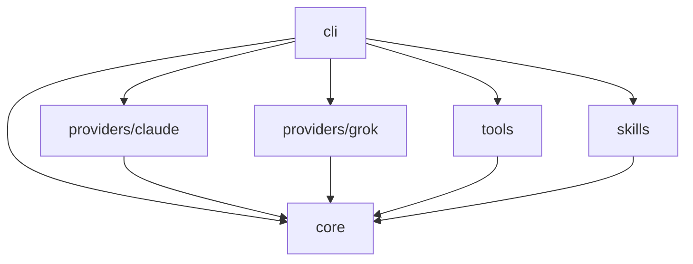
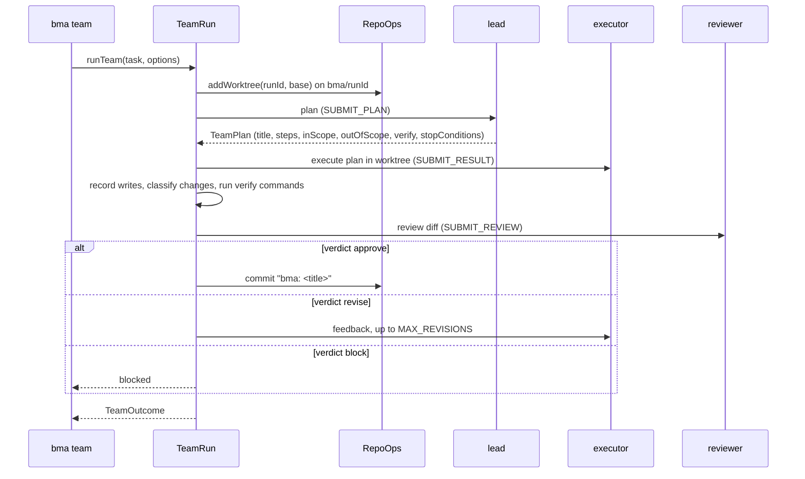
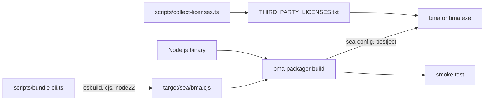

# Architecture

Describes the implemented structure of betaMultiAgent (`bma`): packages, the agent loop, provider mapping, team orchestration, tools and skills, the CLI, and distribution. Security rules are in [security-model.md](./security-model.md); configuration keys are in [configuration.md](./configuration.md).

## Contents
- [Packages and dependency graph](#packages-and-dependency-graph)
- [Agent loop](#agent-loop)
- [Provider mapping](#provider-mapping)
- [Team flow](#team-flow)
- [Tools and skills](#tools-and-skills)
- [CLI layer](#cli-layer)
- [Distribution](#distribution)

## Packages and dependency graph

pnpm workspace (`pnpm-workspace.yaml`): `packages/*` and `packages/providers/*`. A Rust crate at `crates/packager` builds the single-executable binary.

| Directory | Role | Internal dependencies |
|---|---|---|
| [`packages/core`](../packages/core/src/index.ts) | Agent loop, events, messages, sessions, permissions, redaction, usage, team orchestration | none |
| [`packages/providers/claude`](../packages/providers/claude/src/index.ts) | Claude Messages API adapter | core |
| [`packages/providers/grok`](../packages/providers/grok/src/index.ts) | xAI Responses API adapter | core |
| [`packages/tools`](../packages/tools/src/index.ts) | Default tools, local and git-worktree environments, repo operations, process runner | core |
| [`packages/skills`](../packages/skills/src/discover.ts) | Skill discovery, plugin manifests, skill tools | core |
| [`packages/cli`](../packages/cli/src/main.ts) | `bma` command, wiring, output | all of the above |

Boundaries are enforced by `pnpm check:deps` (`node scripts/check-deps.ts`). The script scans TypeScript imports and checks them against [`scripts/lib/dependency-rules.ts`](../scripts/lib/dependency-rules.ts):

- `ALLOWED_INTERNAL` lists the permitted workspace edges. `core` has none; only `cli` may depend on all five other packages.
- `EXCLUSIVE_DEPENDENCIES` restricts vendor SDKs: `@anthropic-ai/sdk` only in `providers/claude`, `@xai-official/sdk` only in `providers/grok`.
- Node builtins must use the `node:` prefix; relative imports must stay inside their package.

## Agent loop

Entry point: [`AgentSession.run`](../packages/core/src/agent/run-session.ts), which delegates to the private `#run` loop. Supporting modules are in [`packages/core/src/agent/`](../packages/core/src/agent/).

| Concern | Module |
|---|---|
| Turn loop, streaming, commit, history replacement | [run-session.ts](../packages/core/src/agent/run-session.ts) |
| Tool preparation and execution | [tool-execution.ts](../packages/core/src/agent/tool-execution.ts) |
| Shared and exclusive gating, semaphore | [concurrency.ts](../packages/core/src/agent/concurrency.ts) |
| Per-path write locks (sorted keys, chained tails) | [path-locks.ts](../packages/core/src/agent/path-locks.ts) |
| Repeated tool-call detection | [loop-detector.ts](../packages/core/src/agent/loop-detector.ts) |
| Summary-based history compaction | [compaction.ts](../packages/core/src/agent/compaction.ts) |
| System prompt and project context | [system-prompt.ts](../packages/core/src/agent/system-prompt.ts) |
| Agent role and turn-outcome schemas | [agent-spec.ts](../packages/core/src/agent/agent-spec.ts) |

Flow of one turn:

1. The loop sends the history and tool specifications to the `Provider` and streams `ProviderEvent`s. Text deltas are forwarded to listeners.
2. The assistant message is committed to the session store and emitted as a `message` event.
3. For each requested tool call, `ToolRuntime.execute` runs in two phases:
   - `#prepare` checks that the tool exists, that the input is valid JSON matching the schema, and that a completion tool is not mixed with other calls. It then requests permission and emits a `permission` event.
   - `#run` acquires the exclusive or shared gate, a semaphore slot, and path locks, then invokes the tool. `tool-start` and `tool-end` events bracket the call.
4. Tool results are appended as messages. The loop repeats until a terminal outcome (`TERMINAL_OUTCOMES`).

Turn outcomes are defined by `TurnOutcomeSchema`: `completed`, `refused`, `budget-exceeded`, `loop-detected`, `max-tokens`, `aborted`, `failed`.

Behavior details:

- **Loop detection.** `LOOP_NUDGE_AT = 3` adds a corrective system note; `LOOP_LIMIT = 12` ends the turn with `loop-detected`. Calls are compared by canonical JSON.
- **Compaction.** A compaction summary must contain the sections in `COMPACTION_SECTIONS`: Goal, Constraints, Decisions, Completed work, Files touched, Current state, Open issues, Next steps, References. `checkSummary` validates them.
- **Project context.** `loadProjectContext` reads workspace instruction files up to `PROJECT_CONTEXT_LIMIT_BYTES` (32 KiB). The loaded sources are reported in a `context-loaded` event.
- **Messages.** Messages are `user`, `assistant`, or `system` notes. Provider-specific replay payloads are kept in `NativeTurnSchema`. Stop reasons are normalized by `StopReasonSchema` (`end`, `tool-calls`, `max-tokens`, `refusal`, `pause`, `context-exceeded`, `other`).

### Sessions and events

- [`SessionStore`](../packages/core/src/session/session-store.ts) appends records to `events.jsonl` with a sequence number and protocol version (`PROTOCOL_VERSION = 1`, [protocol-version.ts](../packages/core/src/events/protocol-version.ts)). `session-start`, `message`, and `outcome` records are fsynced.
- A `session.lock` file marks a running session. `isStale` decides whether a lock is abandoned.
- `replayMessages` rebuilds history from the log.
- Event bodies are defined in [events.ts](../packages/core/src/events/events.ts): `session-start`, `message`, `tool-start`, `tool-end`, `permission`, `usage`, `compaction`, `context-loaded`, `outcome`, `error`, `team-phase`.
- [`UsageLedger`](../packages/core/src/usage/usage.ts) tracks cost. `checkBudget` enforces limits. Cost sources are `exact`, `estimated`, or `unknown`.

### Permissions and redaction

- [`PermissionEngine`](../packages/core/src/permissions/permission-engine.ts) returns allow, ask, or deny. Decisions carry a source: hard deny, rule, session, default, or fallback. A sensitive write revokes a previously allowed exec request.
- An approver answers `allow-once`, `allow-session`, or `deny`.
- [`createRedactor`](../packages/core/src/redaction/redaction.ts) replaces known secrets and token-shaped strings with `REDACTED`.

For the security rules these components implement, see [security-model.md](./security-model.md).

## Provider mapping

Both adapters implement the `Provider` interface in [provider.ts](../packages/core/src/provider/provider.ts) (`id`, `stream(request, signal)`). Errors are classified into `ProviderErrorKind` values, and kinds in `RETRYABLE_KINDS` are retried. Both adapters default to 4 retries.

| Aspect | Claude ([`providers/claude`](../packages/providers/claude/src/provider.ts)) | Grok ([`providers/grok`](../packages/providers/grok/src/provider.ts)) |
|---|---|---|
| SDK | `@anthropic-ai/sdk`, `client.messages.create` with streaming | `@xai-official/sdk`, `client.responses.create`, `stream.done()` |
| Base URL | `https://api.anthropic.com` by default, overridable with `ANTHROPIC_BASE_URL` | overridable with `XAI_BASE_URL` |
| Request mapping | [request.ts](../packages/providers/claude/src/request.ts): `cache_control` ephemeral, adaptive `thinking`, `output_config.effort`, strict tools | [request.ts](../packages/providers/grok/src/request.ts): `store: false`, `prompt_cache_key`, `instructions`, `parallel_tool_calls: true`, `reasoning.effort` |
| Stream mapping | [stream.ts](../packages/providers/claude/src/stream.ts) | [stream.ts](../packages/providers/grok/src/stream.ts) |
| Error mapping | [errors.ts](../packages/providers/claude/src/errors.ts) | [errors.ts](../packages/providers/grok/src/errors.ts) |
| Usage and cost | [usage.ts](../packages/providers/claude/src/usage.ts) | [usage.ts](../packages/providers/grok/src/usage.ts) |
| Catalog | [models.ts](../packages/providers/claude/src/models.ts) | [models.ts](../packages/providers/grok/src/models.ts) |

### Stop reasons

| Provider value | Normalized `StopReason` |
|---|---|
| Claude `end_turn`, `stop_sequence` | `end` |
| Claude `tool_use` | `tool-calls` |
| Claude `max_tokens` | `max-tokens` |
| Claude `pause_turn` | `pause` |
| Claude `refusal` | `refusal` |
| Claude `model_context_window_exceeded` | `context-exceeded` |
| Grok incomplete `max_output_tokens` | `max-tokens` |
| Grok incomplete `max_prompt_tokens` | `context-exceeded` |
| Grok incomplete `content_filter` | `refusal` |

Invalid tool-call JSON is flagged in both streams (`inputError: "invalid-json"` for Claude).

### Model catalog

| Provider | Model | Context window | Max output | Notes |
|---|---|---|---|---|
| Claude | `claude-opus-5-5` | 1,000,000 | 128,000 (default 64,000) | Lead and reviewer roles by default |
| Claude | `claude-sonnet-5-5` | 1,000,000 | 128,000 (default 64,000) | Executor role by default |
| Claude | `claude-haiku-5-5` | 1,000,000 | 128,000 (default 64,000) | Researcher role by default; 100k prompt-token pricing tier |
| Claude | `claude-fable-5-2` | 1,000,000 | 128,000 (default 64,000) | |
| Grok | `grok-4.7` | 500,000 | default 32,000 | Effort levels `low`, `medium`, `high`, `xhigh`; long-context pricing tier at 200k |
| Grok | `grok-4.3` | 1,000,000 | default 32,000 | Effort levels `low`, `medium`, `high`, `xhigh`; long-context pricing tier at 200k |

The Claude catalog has no aliases; model IDs must match exactly. Each catalog dates its pricing with `PRICING_AS_OF`: `2026-11-23` for Claude, `2026-11-20` for Grok. Claude costs are `estimated` from the catalog. Grok uses `cost_usd` when present and marks it `exact`.

Reasoning effort is `EffortSchema`: `low`, `medium`, `high`, `xhigh`, `max`.

## Team flow

`bma team` runs a fixed pipeline in [`TeamRun.#flow`](../packages/core/src/team/run-team.ts). Each run works in a git worktree on branch `bma/<runId>`.

### Roles

Defined in [roles.ts](../packages/core/src/team/roles.ts) (`TEAM_ROLES`).

| Role | Default max turns | Default model (Claude available) | Default model (Grok only) |
|---|---|---|---|
| lead | 40 | `claude-opus-5-5` | `grok-4.7` |
| researcher | 30 | `claude-haiku-5-5` | `grok-4.3` |
| executor | 120 | `claude-sonnet-5-5` | `grok-4.7` |
| reviewer | 40 | `claude-opus-5-5` (`grok-4.7` when Grok is available) | `grok-4.3` |

Each role has a completion tool (`ROLE_COMPLETION_TOOL`). The plan, result, and review completion tools (`SUBMIT_PLAN`, `SUBMIT_RESULT`, `SUBMIT_REVIEW` in [completion-tools.ts](../packages/core/src/team/completion-tools.ts)) validate their input by schema. Completion tool names are reserved (`RESERVED_TEAM_TOOLS`).

### Phases

Phase rules:

1. **Plan.** The lead produces a `TeamPlan`. Titles are at most 72 characters. Verification commands are argv arrays. Plan correction rounds are capped at `MAX_PLAN_CORRECTIONS = 2`.
2. **Execute.** The executor works in the worktree with the tools for its role. Writes are recorded.
3. **Scope check.** [scope-check.ts](../packages/core/src/team/scope-check.ts) rejects absolute paths, `..` segments, and backslashes. It classifies changes as sensitive (build, CI, package, hook, or agent configuration) or out of scope. Sensitive changes are listed in the outcome and summary.
4. **Verify.** [verification-gate.ts](../packages/core/src/team/verification-gate.ts) runs the plan's commands in order and stops at the first failure. Commands must be approved first. `allow` entries run, `ask` entries need an approver or `--yes-verify`, and untrusted workspaces approve nothing. Output is kept to `OUTPUT_TAIL_BYTES = 8192`.
5. **Review.** The reviewer receives the diff, limited to `MAX_REVIEW_DIFF_BYTES = 200 KiB`. Its verdict is `approve`, `revise`, or `block`. Findings have severity `blocker`, `major`, or `minor`. Revisions are capped at `MAX_REVISIONS = 2`.
6. **Commit.** On approval, changes are committed on `bma/<runId>` with the message `bma: <title>`. Commit failures are reported as `commitError`.

Other behavior:

- `delegate` ([delegate-tool.ts](../packages/core/src/team/delegate-tool.ts)) runs up to `MAX_DELEGATE_TASKS = 4` sub-tasks in parallel. Delegation is rejected at depth greater than 0.
- Budget: `#budgetListener` enforces `maxCostUsd`; `#attachSignals` enforces `maxWallMs`.
- Handoff text is built in [handoff.ts](../packages/core/src/team/handoff.ts).

### Team statuses and exit codes

| Status | Exit code |
|---|---|
| `approved` | 0 |
| `failed` | 1 |
| `budget-exceeded` | 3 |
| `needs-human`, `blocked` | 4 |
| `aborted` | 130 |

Repository operations are in [repo-ops.ts](../packages/tools/src/repo/repo-ops.ts). `addWorktree` creates `<worktreesDir>/<runId>` on `bma/<runId>`, with the run ID checked against a pattern. `deleteBranch` accepts only `bma/` names. Commits run with `user.useConfigOnly=true` and `--no-verify --no-gpg-sign`. Git commands go through [git-runner.ts](../packages/tools/src/repo/git-runner.ts), which points `core.hooksPath` at the run's `hooks/` directory and sets a 300-second timeout.

## Tools and skills

### Default tools

[`createDefaultTools`](../packages/tools/src/tools/default-tools.ts) returns these tools, sorted by name:

| Tool | Permission kind | Read-only | Notes |
|---|---|---|---|
| `edit_file` | write | no | |
| `glob` | read | yes | |
| `grep` | read | yes | |
| `read_file` | read | yes | |
| `run_command` | exec | no | Exclusive gate |
| `write_file` | write | no | |

`bma run --role` keeps only read-only tools for read-only roles.

### Process execution

[`run_command`](../packages/tools/src/tools/run-command.ts) takes an argv array (at most 64 elements) and an optional `cwd` that must stay inside the environment root. The default timeout is 120,000 ms and the maximum is 600,000 ms. A timeout or non-zero exit sets `isError`.

[local-environment.ts](../packages/tools/src/environment/local-environment.ts) provides:

- `createLocalEnvironment`, which runs commands in the workspace directly.
- `createGitWorktreeEnvironment`, used for team-run isolation.
- `locateExecutable`, which ignores `PATH` entries that point inside the workspace.
- A child environment built by `buildChildEnv`.

[spawn-runner.ts](../packages/tools/src/process/spawn-runner.ts) starts processes with `shell: false`. On POSIX the child runs in a detached process group: SIGTERM is sent first and SIGKILL after 5 seconds. On Windows the tree is stopped with `taskkill /T /F`. `FORCE_FINISH_MS = 7000` bounds the wait. `killTrackedProcessTreesSync` cleans up at exit.

Security rules for these tools are described in [security-model.md](./security-model.md).

### Skills

[`discoverSkills`](../packages/skills/src/discover.ts) searches, in order:

1. Repository directories `.bma/skills`, `.claude/skills`, `.agents/skills`, only when the workspace is trusted.
2. User `skills` directory.
3. User `plugins` directory.
4. Extra absolute roots.

The first skill with a given name wins. Symbolic links are skipped.

A skill is a directory with `SKILL.md`. [frontmatter.ts](../packages/skills/src/frontmatter.ts) parses YAML with aliases disabled (`maxAliasCount: 0`). The `name` must match `^[a-z0-9][a-z0-9-]{0,63}$`; `description` is 1 to 1024 characters. Size limits are in [limits.ts](../packages/skills/src/limits.ts): manifest 1 MiB, `SKILL.md` 64 KiB, skill asset 256 KiB.

Plugin manifests are read from `<format>/plugin.json` for three formats (`MANIFEST_FORMATS`):

| Format directory | Source |
|---|---|
| `.claude-plugin` | Claude plugin manifest |
| `.cursor-plugin` | Cursor plugin manifest |
| `.grok-plugin` | Grok plugin manifest |

The default skills path is `skills`. Manifest fields listed in `UNSUPPORTED_FIELDS` (hooks, commands, agents, `mcpServers`, `lspServers`) are not supported.

[skill-tools.ts](../packages/skills/src/skill-tools.ts) provides two tools:

- `load_skill` reads `SKILL.md` under a read permission.
- `read_skill_file` reads other files, which must stay inside the skill directory.

[catalog.ts](../packages/skills/src/catalog.ts) renders the skill catalog that is added to the system prompt.

## CLI layer

Entry: [`packages/cli/bin/bma.js`](../packages/cli/bin/bma.js) imports `runCli` from the compiled `dist/main.js`.

| Module | Responsibility |
|---|---|
| [main.ts](../packages/cli/src/main.ts) | Help text, command dispatch, exit-code mapping, console redirection when `--json` |
| [wiring.ts](../packages/cli/src/wiring.ts) | Builds redactor, model resolver, workspace, environment, permission engine, tools, team roles |
| [config/paths.ts](../packages/cli/src/config/paths.ts) | State and config directories, workspace root checks, project keys |
| [cli-error.ts](../packages/cli/src/cli-error.ts) | Exit codes |
| `commands/*.ts` | `run`, `team` (with `team clean`), `sessions`, `models`, `doctor`, `trust` |
| [approver/tty-approver.ts](../packages/cli/src/approver/tty-approver.ts) | Interactive permission and command prompts |
| `audit/*.ts` | Audit ledger: monthly JSONL files, retention, reader, and the session-log tap that records permissions and per-role cost |

### Exit codes

| Code | Constant | Meaning |
|---|---|---|
| 0 | `EXIT_OK` | Success |
| 1 | `EXIT_FAILED` | Failure |
| 2 | `EXIT_USAGE` | Usage or configuration error |
| 3 | `EXIT_BUDGET` | Budget exceeded |
| 4 | `EXIT_STOPPED` | Refused, blocked, or needs human review |
| 130 | `EXIT_INTERRUPTED` | Interrupted |

### Commands

| Command | Behavior |
|---|---|
| `bma run` | One agent session. Flags: `--prompt`/`-p`, `--prompt-file`/`-f`, `--model`/`-m`, `--role` (default `executor`), `--json`. Session log is stored under the project's sessions directory. |
| `bma team <task>` | Full team pipeline. Flags: `--task-file`/`-f`, `--allow-dirty`, `--max-cost`, `--yes-verify`, `--json`. Run directory is `<runsDir>/<runId>` with a `hooks/` subdirectory. |
| `bma team clean` | Removes a run's worktree, and optionally branch `bma/<runId>` with `--delete-branch`. Lists uncommitted changes first. Outside a terminal, `--yes` is required. |
| `bma sessions` | `list` (default), `show <id>`, `rm <id>`, `prune [--older-than <days>]` (default 30). Locked sessions are not removed by `rm` or `prune`. |
| `bma models` | Prints the catalog of both providers. `--provider claude\|grok`, `--json`. |
| `bma doctor` | Checks Node, platform, git, keys, hosts, state directory mode, workspace, trust, config, instructions, skills, long paths on Windows, and sandbox status. Exits 1 when an error-level check fails. |
| `bma trust` | Lists workspace trust records and asks for confirmation. `--revoke` removes trust. Trust is bound to the SHA-256 of `bma.config.json`. |

### Directories

Resolved by [`resolveDirs`](../packages/cli/src/config/paths.ts):

| Platform | State | Config |
|---|---|---|
| Windows | `%LOCALAPPDATA%\betaMultiAgent` | `%APPDATA%\betaMultiAgent` |
| macOS | `~/Library/Application Support/betaMultiAgent/state` | `~/Library/Application Support/betaMultiAgent/config` |
| Linux and others | `$XDG_STATE_HOME/betaMultiAgent` | `$XDG_CONFIG_HOME/betaMultiAgent` |

`BMA_HOME` overrides these into one directory with `state/` and `config/` subdirectories. Per-project state lives under `<state>/projects/<key>`, where `<key>` is the first 16 hex characters of the SHA-256 of the workspace root. Worktrees are under `<state>/worktrees`.

`resolveWorkspaceRoot` refuses to run in the home directory, a filesystem root, or a directory that contains bma's own state.

### Audit ledger

`bma run` and `bma team` open an `AuditLedger` in `<state>/projects/<key>/audit`. An `AuditRecorder` wraps each session's event sink: it forwards every record unchanged, writes `permission` records, and counts tool results rejected as `INVALID_INPUT`. The run writes `run-start` before the first session and `run-outcome` after it ends. Per-role cost comes from `TeamOutcome.usageByRole`, which `runTeam` sums from one usage ledger per role. The core event protocol is unchanged. Record fields: [configuration.md](./configuration.md#audit-ledger).

### Wiring

[wiring.ts](../packages/cli/src/wiring.ts) assembles the runtime:

- `createCliRedactor` redacts the provider credential environment variables.
- `createModelResolver` resolves `provider:id` model strings.
- `createEnvironment` builds a `local` or `git-worktree` environment.
- `createTools` combines the default tools with the skill tools.
- `createPermissionEngine` attaches an interactive approver when a terminal is available.

Configuration files and their keys are described in [configuration.md](./configuration.md).

### Output

- **Human output** ([human.ts](../packages/cli/src/output/human.ts)): `HumanRenderer` writes assistant text to stdout and status lines (session, tool calls, permissions, compaction, errors, team phases) to stderr. `TerminalWriter` sanitizes and redacts all terminal output.
- **JSONL output** ([jsonl.ts](../packages/cli/src/output/jsonl.ts)): `--json` writes one redacted JSON object per line. `writeResult(type, body)` adds `v` and `type`. Team runs end with a `team-outcome` line.

## Distribution

Distribution produces one executable per platform that embeds Node.js and the bundled CLI.

### Bundling

[`scripts/bundle-cli.ts`](../scripts/bundle-cli.ts) bundles the CLI entry with esbuild into `target/sea/bma.cjs` (CommonJS, `node22` target, `source` export condition). It also writes `meta.json` (the esbuild metafile) and `version.txt`. The version comes from `BMA_VERSION` or `packages/cli/package.json`.

### Packager

[`crates/packager`](../crates/packager/src/steps.rs) is a Rust binary (`bma-packager build`). Options are defined in [args.rs](../crates/packager/src/args.rs):

| Option | Purpose |
|---|---|
| `--out <dir>` | Output directory (default `<root>/dist/bin`) |
| `--root <dir>` | Repository root; must contain `scripts/bundle-cli.ts` |
| `--node <path>` | Node.js binary to embed (default: `node` on `PATH`) |
| `--official-node` | Download the official Node.js release matching the host and verify `SHASUMS256.txt` with pinned release keys |
| `--node-license <path>` | Node.js LICENSE file; otherwise searched next to the binary |
| `--gpg <program>` | gpg executable for `--official-node` (default `gpg`) |
| `--skip-smoke` | Skip the smoke test |

Build steps in [steps.rs](../crates/packager/src/steps.rs):

1. Run `scripts/bundle-cli.ts` into `target/sea`.
2. Resolve the Node.js binary and its version.
3. Run `scripts/collect-licenses.ts` to write `THIRD_PARTY_LICENSES.txt`.
4. Write `sea-config.json` (`useSnapshot` and `useCodeCache` disabled) and run `node --experimental-sea-config`.
5. Copy the Node.js binary to `bma` (or `bma.exe`). On macOS, remove its signature.
6. Inject the blob with `postject` (`node_modules/postject/dist/cli.js`) using the SEA sentinel fuse. On macOS, pass the `NODE_SEA` Mach-O segment name and apply an ad-hoc signature.
7. Smoke test, unless skipped: `--version` must print the bundled version; `doctor --json` must emit valid JSON lines including a `doctor` result; `run --help` must succeed. The test uses a temporary `BMA_HOME` and removes the provider key variables from the environment.

### License collection

[`scripts/collect-licenses.ts`](../scripts/collect-licenses.ts) uses [license-collector.ts](../scripts/lib/license-collector.ts) to read the bundled packages from the esbuild metafile and their license files. It combines them with the project `LICENSE` and the Node.js license into `THIRD_PARTY_LICENSES.txt`.

### CI

[`.github/workflows/ci.yml`](../.github/workflows/ci.yml) runs on pushes to `main` and on pull requests:

| Job | Matrix | Steps |
|---|---|---|
| `node` | Ubuntu, macOS, Windows × Node 22, 24, 26 | `pnpm install --frozen-lockfile`, `check:comments`, `check:deps`, `lint`, `typecheck`, `test`, `build` |
| `rust` | Ubuntu, macOS, Windows | `cargo fmt --all --check`, `cargo clippy -D warnings`, `cargo test --workspace` |
| `package` | macOS, Windows | `pnpm build`, `cargo run -p bma-packager --release -- build --out dist/bin`, upload artifact |

Linux binaries are not packaged by CI or the release workflow.

### Release

[`.github/workflows/release.yml`](../.github/workflows/release.yml) runs on tags matching `v*`:

1. `build` (macOS and Windows) packages with `--official-node`. The Windows job passes the Git for Windows gpg path to `--gpg`. Each job archives the binary, `THIRD_PARTY_LICENSES.txt`, and `LICENSE` as `bma-<version>-<runner os>-<runner arch>` (`.tar.gz` on macOS, `.zip` on Windows).
2. `publish` (Ubuntu) downloads the archives, writes `SHA256SUMS`, creates build provenance attestations, and runs `gh release create` with generated notes and `--verify-tag`.

Workflow actions are pinned to commit SHAs. Permissions are `contents: read` for the build job and widened only in `publish`.

Build prerequisites and local commands are in [development.md](./development.md).
